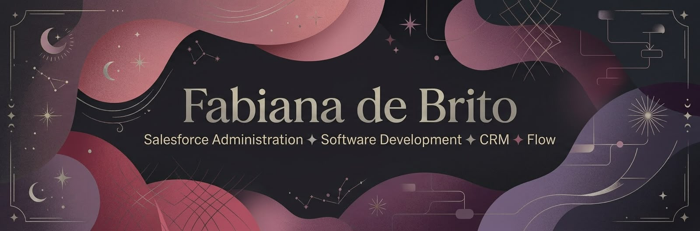
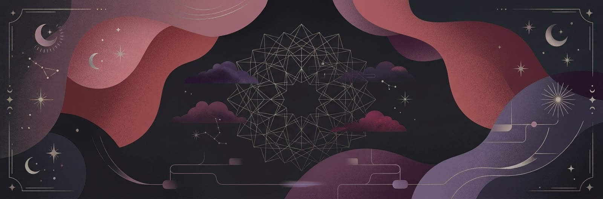

<!-- IMAGEM DO TOPO -->

<!-- FRASES ANIMADAS EM PINK -->

 

<!-- REDES SOCIAIS: MAGENTA E ROSA-CHOQUE -->

 

✦ ────────── ☾ ✧ ☽ ────────── ✦

---

## 🌙 ✧ Sobre mim

Sou estudante de Engenharia de Software e desenvolvedora, com experiência na manutenção e evolução de sistemas. Atualmente, estou aprofundando meus conhecimentos em Salesforce e Apex.

Gosto de unir lógica, criatividade e curiosidade para entender como as coisas funcionam e transformar ideias em soluções.

☾ Tecnologia, games, fantasia e universos cósmicos fazem parte das inspirações que levo para meus projetos.

✧ *Cada descoberta abre um novo caminho.*

---

## 🔮 ✧ Meu arsenal de tecnologia

---

## 💣 ✧ Meu mapa gamer

✦ *Explorando o mapa, resolvendo desafios e construindo meu caminho.*

---

## 🌌 ✧ Minhas estatísticas no GitHub

  

---

✦ ────────── ☾ ✧ ☽ ────────── ✦

**୨୧ Entre estrelas, pixels e possibilidades. ✦**

Feito com criatividade, código e um toque de magia. 🌙

  

<!-- IMAGEM DO FINAL -->

